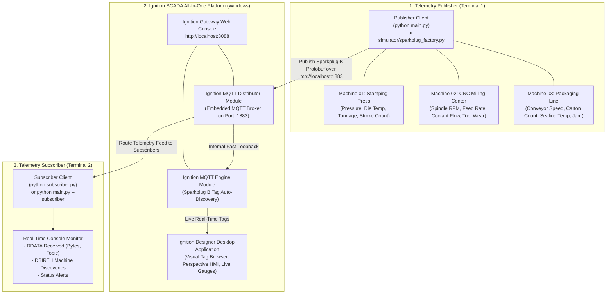

# Industrial MQTT with Ignition SCADA — Complete Operations Handbook

> **Overview:** A complete, self-contained guide for connecting an **Industrial MQTT telemetry pipeline into Ignition SCADA**.
> In this setup:
> - **Ignition SCADA** serves as the complete platform: it hosts the built-in **MQTT Broker (MQTT Distributor)** on port 1883 and automatically builds tag trees using **MQTT Engine**.
> - **Publisher (`main.py` or `main.py --publisher`)**: Simulates 3 factory machines (Stamping Press, CNC, Packaging) publishing live Sparkplug B telemetry to Ignition every 2 seconds.
> - **Subscriber (`subscriber.py` or `main.py --subscriber`)**: Connects to Ignition to receive, monitor, and log incoming telemetry packets in real-time.
> - **Ignition Designer**: Visualizes the incoming data on live analog gauges and status indicators.
> *(No external Mosquitto broker, no database, and no `uv` required).*

---

## 1. Official Windows Download Links

Every tool needed for this setup runs natively on Windows:

| Software / Component | Official Download Link | Description / Installation Notes |
| :--- | :--- | :--- |
| **Ignition SCADA Gateway (8.1 / 8.3)** | [Inductive Automation Downloads](https://inductiveautomation.com/downloads/) | `ignition-8.x.x-windows-x64-installer.exe` (Runs natively as a Windows Service). |
| **Ignition Designer Launcher** | Downloaded from your running Gateway: `http://localhost:8088` (Home ➔ **Get Designer**) or [Inductive Automation Downloads](https://inductiveautomation.com/downloads/) | `designerlauncher.exe` (Desktop app for designing dashboards, tags, and gauges). |
| **Cirrus Link MQTT Distributor Module** | [Cirrus Link Module Downloads](https://sales.cirrus-link.com/download-modules/) | `MQTT-Distributor-signed.modl` (Turns Ignition Gateway into an internal MQTT Broker on port 1883). |
| **Cirrus Link MQTT Engine Module** | [Cirrus Link Module Downloads](https://sales.cirrus-link.com/download-modules/) | `MQTT-Engine-signed.modl` (Consumes Sparkplug B & auto-creates SCADA tags). |
| **Python (>= 3.10)** | [Python for Windows](https://www.python.org/downloads/windows/) | Official Python installer. Standard `pip install -r requirements.txt` is used. |

---

## 2. Streamlined System Architecture (Publisher & Subscriber Flow)



---

## 3. Step-by-Step Installation on Windows

### Step 1: Install Python & Project Dependencies using `pip`
1. Download Python from [python.org](https://www.python.org/downloads/windows/).
2. Run installer and ensure you check the box: **`[x] Add python.exe to PATH`**.
3. Open **Windows PowerShell** or **Command Prompt** in the project folder:
   ```powershell
   cd industrial-mqtt
   python -m venv .venv
   .\.venv\Scripts\Activate.ps1
   pip install -r requirements.txt
   ```
   *(`requirements.txt` contains only `paho-mqtt` and `pysparkplug`).*

### Step 2: Install Ignition Gateway on Windows
1. Download `ignition-8.x.x-windows-x64-installer.exe` from [Inductive Automation](https://inductiveautomation.com/downloads/).
2. Double-click installer ➔ Select Typical Installation ➔ Click Install.
3. Open your browser to: **[http://localhost:8088](http://localhost:8088)**.
4. Follow commissioning wizard:
   - Choose **Maker Edition** (free for personal use) or **Standard Trial** (renewable 2-hour trial).
   - Set up your **Admin username** (e.g. `admin`) and **password**.
   - Click **Start Gateway**.

---

## 4. Installing & Enabling MQTT Modules in Ignition

Two Cirrus Link `.modl` plugins enable Ignition to act as both the broker and SCADA client:

### 4.1 Step 1: Download & Upload the Modules
1. Visit the [Cirrus Link Module Downloads page](https://sales.cirrus-link.com/download-modules/).
2. Download:
   - `MQTT-Distributor-signed.modl`
   - `MQTT-Engine-signed.modl`
3. In browser at `http://localhost:8088`, go to **Config ➔ System ➔ Modules**.
4. Scroll to bottom and click **Install or Upgrade a Module...**.
5. Upload `MQTT-Distributor-signed.modl` ➔ accept EULA ➔ click **Confirm**.
6. Repeat for `MQTT-Engine-signed.modl` ➔ accept EULA ➔ click **Confirm**.
7. Confirm both modules show green status: **Running**.

### 4.2 Step 2: Verify the Embedded Broker (MQTT Distributor)
1. Under **Config**, click **MQTT DISTRIBUTOR ➔ Settings**.
2. Notice:
   - **Port:** `1883` (Standard MQTT port).
   - **Enable Plaintext:** Checked.
3. Click **Users**:
   - Default credentials are: **Username:** `admin` | **Password:** `changeme`.
4. Ignition is now running a live, native MQTT Broker on port 1883.

### 4.3 Step 3: Verify the MQTT Engine Connection
1. Under **Config**, click **MQTT ENGINE ➔ Settings ➔ Servers**.
2. Verify server points to `tcp://localhost:1883`. Status shows **Connected** with a green checkmark.

---

## 5. Running the Publisher & Subscriber Simultaneously

Open **two terminal windows** side-by-side to see data publishing and receiving in real-time:

### 5.1 Terminal 1: Run the Publisher (Sending Data)
In PowerShell Terminal 1, start the publisher:
```powershell
python main.py
```
**Publisher Console Output:**
```text
======================================================================
  Sparkplug B Industrial Factory Line -> Ignition SCADA
======================================================================
Target Broker: tcp://localhost:1883
Registered 3 distinct devices with customized parameters.

[MQTT] Connecting to Ignition MQTT Broker at localhost:1883...
[MQTT] Connected! Sent NBIRTH & DBIRTH packets.
[MQTT] Streaming live telemetry every 2 seconds. Press Ctrl+C to stop.

[20:10:01] Cycle #1:
  • Stamping : Status=1 | Bar=184.2 | Temp=62.4°C | Strokes=1423
  • CNC      : Status=1 | RPM=3850 | Wear=14.51% | Coolant=18.4L/min
  • Packaging: Status=1 | Speed=1.31m/s | Cartons=893 | Jam=False
```

### 5.2 Terminal 2: Run the Subscriber (Receiving Data)
In PowerShell Terminal 2, start the subscriber client:
```powershell
python subscriber.py
```
*(Or run `python main.py --subscriber`)*

**Subscriber Console Output (Receiving in Real-Time):**
```text
======================================================================
  Ignition MQTT Subscriber Client (Telemetry Receiver)
======================================================================
Target Broker: tcp://localhost:1883
Listening on:  spBv1.0/#
----------------------------------------------------------------------
[SUBSCRIBER] Connected successfully to Ignition MQTT Broker!
[SUBSCRIBER] Subscribed to topic pattern: spBv1.0/#
[SUBSCRIBER] Waiting for live machine data... (Press Ctrl+C to stop)

[20:10:01] [DDATA RECEIVED] Machine: Machine01_Stamping    | Bytes:  164 | Topic: spBv1.0/Plant1/DDATA/Line1/Machine01_Stamping
[20:10:01] [DDATA RECEIVED] Machine: Machine02_CNC         | Bytes:  188 | Topic: spBv1.0/Plant1/DDATA/Line1/Machine02_CNC
[20:10:01] [DDATA RECEIVED] Machine: Machine03_Packaging   | Bytes:  172 | Topic: spBv1.0/Plant1/DDATA/Line1/Machine03_Packaging
```

---

## 6. Seeing Tags & Building Live Gauges in Ignition Designer

### 6.1 Launching Designer
1. On your running Gateway (`http://localhost:8088`), go to the **Home** tab.
2. Under **Get Designer**, download `designerlauncher.exe`.
3. Open Designer Launcher from your Start Menu or Desktop.
4. Click **Launch** next to `http://localhost:8088` and log in.
5. Click **New Project** ➔ Name it `Factory_Overview` ➔ click **Create Project**.

### 6.2 Locating the Auto-Discovered Tags
1. In Designer, open the **Tag Browser** pane on the left.
2. At the top of Tag Browser, switch tag provider from `[default]` to **`[MQTT Engine]`**.
3. Expand the folder tree:
   ```text
   [MQTT Engine]
     └── Edge Nodes
           └── Plant1
                 └── Line1
                       ├── Machine01_Stamping
                       │     ├── Die_Temperature_C
                       │     ├── Hydraulic_Pressure_Bar
                       │     ├── Lubrication_Level_Pct
                       │     ├── Status
                       │     ├── Stroke_Count
                       │     └── Tonnage_Actual_Tons
                       ├── Machine02_CNC
                       │     ├── Axis_X_Pos_mm
                       │     ├── Coolant_Flow_L_min
                       │     ├── Feed_Rate_mm_min
                       │     ├── Spindle_RPM
                       │     ├── Status
                       │     └── Tool_Wear_Pct
                       └── Machine03_Packaging
                             ├── Carton_Count
                             ├── Conveyor_Speed_m_s
                             ├── Glue_Level_Pct
                             ├── Jam_Alarm
                             ├── Sealing_Temp_C
                             └── Status
   ```
4. Values update live with green indicators every 2 seconds.

### 6.3 Binding a Live Gauge to Machine Telemetry
1. In **Project Browser** (top left), expand **Perspective ➔ Views** ➔ Right-click **New View...** ➔ `Machine_Overview`.
2. From the Component Palette, drag a **Gauge** component onto the canvas.
3. In the **PROPS** panel on the bottom-right, locate the `value` property and click the **Binding icon**.
4. In the binding window:
   - Select **Tag** on the left.
   - Browse to:
     `[MQTT Engine]Edge Nodes/Plant1/Line1/Machine01_Stamping/Hydraulic_Pressure_Bar`
   - Click **OK**.
5. Set `minValue: 0`, `maxValue: 250`, `units: Bar`.
6. Drag a **Label** component for status, bind text to `.../Machine01_Stamping/Status`, and add a Map transform (`1 -> "RUNNING"`, `0 -> "STOPPED"`).
7. The gauge needle and status animate live on your screen, perfectly in sync with the publisher and subscriber!

---

## 7. Windows Commands Quick Reference

| Action | Windows PowerShell / Command Prompt |
| :--- | :--- |
| **Activate Python Virtual Environment** | `.\.venv\Scripts\Activate.ps1` |
| **Install Dependencies** | `pip install -r requirements.txt` |
| **Check Ignition Port 1883** | `netstat -ano | findstr 1883` |
| **Start Ignition Service** | `net start Ignition` *(or via `services.msc`)* |
| **Stop Ignition Service** | `net stop Ignition` |
| **Run Publisher (Send Telemetry)** | `python main.py` |
| **Run Subscriber (Receive Telemetry)** | `python subscriber.py` *(or `python main.py --subscriber`)* |
| **Open Ignition Gateway Web Console** | In browser: **`http://localhost:8088`** |

---

## 8. Complete Source Code & Project Structure

Place these files inside your `industrial-mqtt\` directory on Windows:

```text
industrial-mqtt\
├── main.py                          (Main application: Publisher or Subscriber)
├── subscriber.py                    (Dedicated standalone subscriber script)
├── requirements.txt                 (Python dependencies)
├── IGNITION_MQTT_OPERATIONS_GUIDE.md(Complete handbook)
└── simulator\
    └── sparkplug_factory.py         (Multi-machine Sparkplug B telemetry engine)
```

### 8.1 `main.py`
```python
"""Industrial Factory Line -> Ignition SCADA Main Application.

Provides two modes:
  1. Publisher (Default): Simulates factory machines streaming live telemetry into Ignition.
  2. Subscriber: Receives and displays live telemetry streamed from Ignition.

Run Publisher:
    python main.py
    (or: python main.py --publisher)

Run Subscriber:
    python main.py --subscriber
    (or: python subscriber.py)
"""

import sys
import os

sys.path.insert(0, os.path.dirname(os.path.abspath(__file__)))


def run_publisher():
    # Import the standalone publisher logic
    import simulator.sparkplug_factory as sim
    sim.main()


def run_subscriber():
    # Import subscriber logic
    import subscriber
    subscriber.main()


if __name__ == "__main__":
    if "--subscriber" in sys.argv or "-s" in sys.argv:
        run_subscriber()
    else:
        run_publisher()
```

### 8.2 `subscriber.py`
```python
"""Ignition MQTT Subscriber Client.

Subscribes directly to Ignition SCADA's MQTT Distributor broker (port 1883).
Listens to live telemetry from the factory machines and prints received parameters in real-time.

Run with:
    python subscriber.py
"""

import time
import paho.mqtt.client as mqtt

# ==============================================================================
# 1. MQTT CONNECTION CONFIGURATION
# ==============================================================================
BROKER_HOST = "localhost"   # Address of Ignition Gateway running MQTT Distributor
BROKER_PORT = 1883          # Default MQTT port on Ignition
MQTT_USERNAME = "admin"     # Ignition MQTT Distributor default user (optional)
MQTT_PASSWORD = "changeme"  # Ignition MQTT Distributor default password (optional)

# Sparkplug B Telemetry Topic: spBv1.0/<GROUP>/DDATA/<EDGE_NODE>/<DEVICE>
# We subscribe to '#' to capture all telemetry, births, and deaths across all machines
TOPIC_SPARKPLUG_ALL = "spBv1.0/#"


def on_connect(client, userdata, flags, rc):
    """Callback triggered when subscriber connects to Ignition MQTT Distributor."""
    if rc == 0:
        print("[SUBSCRIBER] Connected successfully to Ignition MQTT Broker!")
        # Subscribe to all Sparkplug B telemetry topics with QoS 1
        client.subscribe(TOPIC_SPARKPLUG_ALL, qos=1)
        print(f"[SUBSCRIBER] Subscribed to topic pattern: {TOPIC_SPARKPLUG_ALL}")
        print("[SUBSCRIBER] Waiting for live machine data... (Press Ctrl+C to stop)\n")
    else:
        print(f"[SUBSCRIBER] Connection failed with error code: {rc}")


def on_message(client, userdata, msg):
    """Callback triggered whenever a machine publishes data."""
    topic = msg.topic
    payload_len = len(msg.payload)
    timestamp_str = time.strftime("%H:%M:%S")

    # Topic format: spBv1.0/Plant1/DDATA/Line1/Machine01_Stamping
    topic_parts = topic.split("/")
    msg_type = topic_parts[2] if len(topic_parts) > 2 else "UNKNOWN"
    device_id = topic_parts[4] if len(topic_parts) > 4 else "EdgeNode"

    if msg_type == "DDATA":
        print(f"[{timestamp_str}] [DDATA RECEIVED] Machine: {device_id:20} | Bytes: {payload_len:4} | Topic: {topic}")
    elif msg_type == "DBIRTH":
        print(f"[{timestamp_str}] [DBIRTH DISCOVERY] Machine Registered: {device_id} (New Tag Tree Created in Ignition)")
    elif msg_type == "NBIRTH":
        print(f"[{timestamp_str}] [NBIRTH DISCOVERY] Line Online: {topic_parts[3] if len(topic_parts) > 3 else ''}")
    elif msg_type == "DDEATH":
        print(f"[{timestamp_str}] [DDEATH WARNING] Machine Offline: {device_id}")
    else:
        print(f"[{timestamp_str}] [{msg_type}] Topic: {topic} ({payload_len} bytes)")


def on_disconnect(client, userdata, rc):
    if rc != 0:
        print("[SUBSCRIBER] Unexpected disconnection from Ignition. Reconnecting...")


def main():
    print("=" * 70)
    print("  Ignition MQTT Subscriber Client (Telemetry Receiver)")
    print("=" * 70)
    print(f"Target Broker: tcp://{BROKER_HOST}:{BROKER_PORT}")
    print(f"Listening on:  {TOPIC_SPARKPLUG_ALL}")
    print("-" * 70)

    client = mqtt.Client(client_id="ignition_telemetry_subscriber", clean_session=True)
    if MQTT_USERNAME:
        client.username_pw_set(MQTT_USERNAME, MQTT_PASSWORD)

    client.on_connect = on_connect
    client.on_message = on_message
    client.on_disconnect = on_disconnect

    try:
        client.connect(BROKER_HOST, BROKER_PORT, keepalive=60)
        client.loop_forever()
    except KeyboardInterrupt:
        print("\n[SUBSCRIBER] Stopping subscriber...")
        client.disconnect()
        print("[SUBSCRIBER] Disconnected.")
    except Exception as ex:
        print(f"\n[ERROR] Could not connect to Ignition: {ex}")
        print("Ensure Ignition Gateway is running at http://localhost:8088 with MQTT Distributor.")


if __name__ == "__main__":
    main()
```

### 8.3 `requirements.txt`
```text
paho-mqtt<2.0.0
pysparkplug>=0.3.0
```
